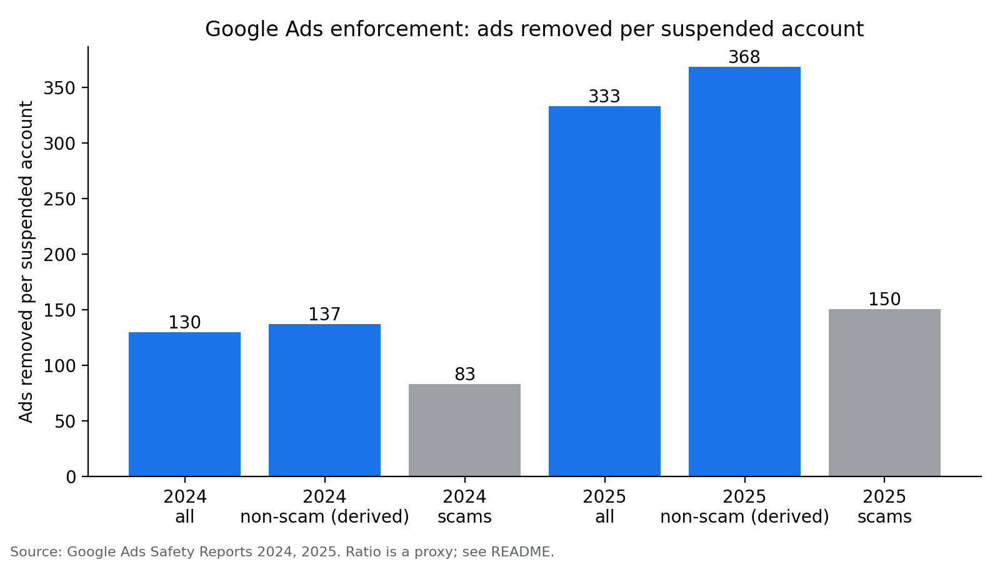

# Ads removed per suspended account

A small analysis of Google's public Ads Safety Reports, asking one question:
**is Google enforcing more at the ad level and less at the account level?**

The proxy is simple: ads removed ÷ advertiser accounts suspended.

| Year | Scope | Ads removed | Accounts suspended | Ads per account |
|---|---|---|---|---|
| 2024 | all | 5.1B | 39.2M | 130 |
| 2024 | non-scam (derived) | 4.7B | 34.2M | 137 |
| 2024 | scams | 0.4B | 5.0M | 83 |
| 2025 | all | 8.3B | 24.9M | 333 |
| 2025 | non-scam (derived) | 7.7B | 20.9M | 368 |
| 2025 | scams | 0.6B | 4.0M | 150 |

All figures are lower bounds: Google reports them as "over" or "+".



## Run it

```bash
pip install "matplotlib>=3.7"
python analysis.py
```

matplotlib is the only dependency, and it's only used to draw the chart. Everything else
comes from Python's standard library. Without matplotlib, the script still prints the table
and skips the chart.

## Read this before quoting the number

The ratio is a proxy, and a leaky one.

1. **Different populations.** Removed ads include ads from accounts that were never suspended,
   and suspended accounts include accounts that never ran an ad. Google's 2024 report says the
   "vast majority" of its 39.2M suspensions happened before the account served a single ad. The ratio does not mean "the average banned account had 333 ads."
2. **Two data points.** 2024 vs 2025 is a comparison, not a trend. Add earlier years from
   Google's archived reports to `data/ads_safety_report.csv` to build a real series.
3. **Some of the drop may be fewer mistakes.** Google's 2025 report says Gemini cut incorrect
   advertiser suspensions by 80%. Part of the decline in suspensions may be fewer wrong calls.
4. **Definitions drift.** Check each report's definitions of "removed", "blocked" and "restricted"
   before comparing years.

## Data

Every row in `data/ads_safety_report.csv` carries its source URL and a `verified` flag.
Flip it to `TRUE` once you've checked the number against the primary report.

Built from public data only. Not affiliated with Google.
